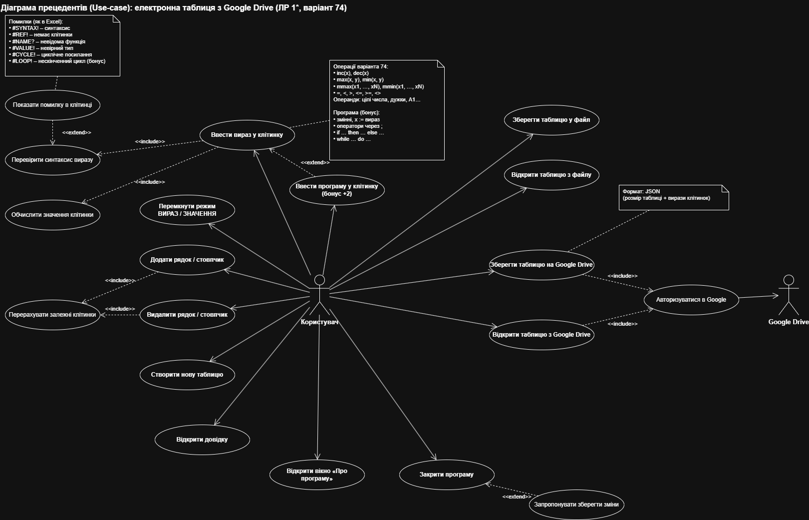
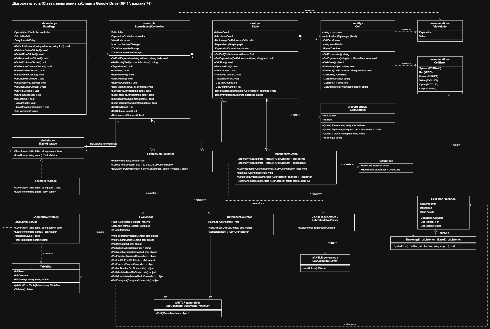
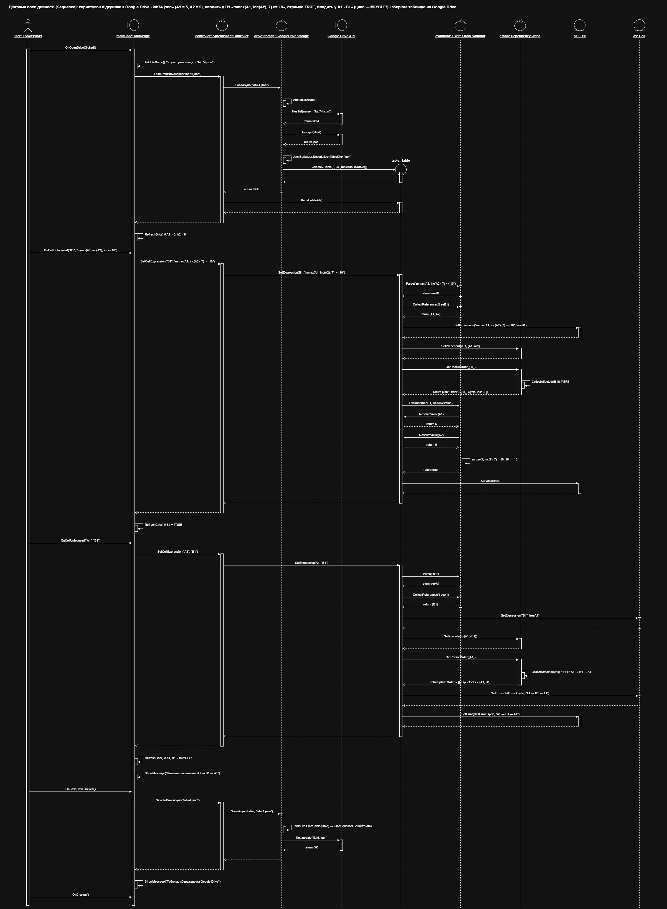

# Lab 1*. Spreadsheet

OOP, 2nd year. C#, .NET MAUI, ANTLR4.

Variant 74, operations:
- inc(x), dec(x)
- max(x, y), min(x, y)
- mmax(x1, ..., xN), mmin(x1, ..., xN)
- =, <, >, <=, >=, <>

Integers of any length, cells can reference other cells (A1, B2, etc.).
The table can be saved to a file or to Google Drive.

Bonus: a cell can contain a small program with variables, if and while.

## UML diagrams

Use-case:

Class:

Sequence:

draw.io file: docs/uml/lab1_uml.drawio
